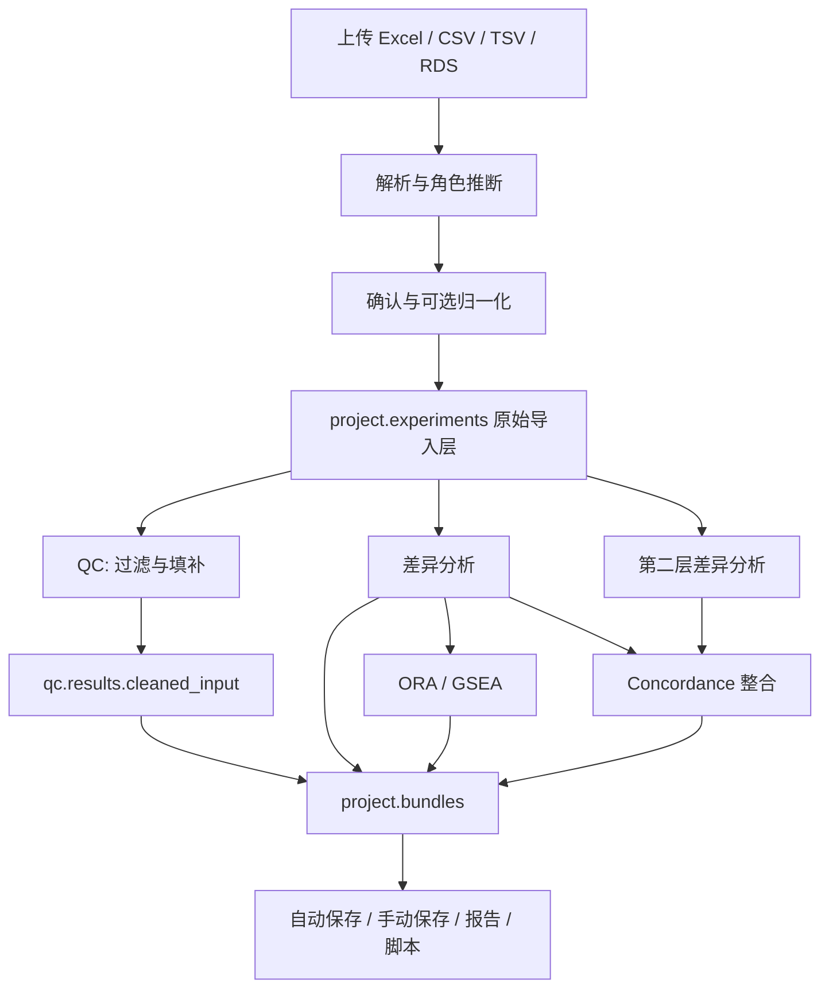

# omicsApp 部署前完整审查

审查日期：2026-09-07  
代码基线：`f756751`，完整提交号见 [summary.json](evidence/summary.json)。审查开始时工作树干净。  
审查环境：macOS ARM64、R 4.4.3；目标方案为 Ubuntu 上 nginx → ShinyProxy 3.2.4 → 每用户 R 容器，Keycloak 26.7.3 + PostgreSQL 16 提供身份认证。  
本次交付是审查报告与验证证据；应用代码和部署配置中的问题尚未修复。

## 1. 部署结论

**当前不建议作为正式多用户分析服务上线。可以继续在隔离的测试环境进行部署演练。**

框架已经具备可运行的分析引擎、七个页面、项目存储、数据归档和相当广的测试覆盖。主要不足不是缺少算法实现，而是**外部输入进入执行环境的边界、分析步骤之间的数据传递，以及项目和结果之间的来源对应关系**。

本次审查确认了两条代码执行入口，以及多项会产生“页面正常、结果不对应实际数据或设置”的问题。这些问题比页面报错更需要在上线前解决。常规测试和包检查全部通过，不能替代这些验证。

优先级定义：

- **P1：正式部署前必须处理。** 可执行非预期代码、产生错误科学结果，或破坏宣称的恢复能力。
- **P2：应纳入此次发布修复，或通过明确的功能限制和部署措施消除影响。** 不能无说明地作为已支持能力交付。
- **部署验收门槛：** 需要目标服务器证据；本地静态检查不能替代。

| 编号 | 级别 | 问题 | 证据性质 |
|---|---|---|---|
| A01 | P1 | 元数据列名被拼进 R 公式，可以执行代码 | Excel 导入后实际复现 |
| A02 | P1 | RDS 中的活动绑定可在导入解析时执行代码 | 无害标记文件复现 |
| A03 | P1 | QC 清洗结果没有进入差异分析 | 实际模块调用复现 |
| A04 | P1 | 归一化失败仍提交原始强度，limma 将其结果标为 log2FC | 故障注入 + 实际 limma 复现 |
| A05 | P1 | 导出脚本漏掉归一化，重跑产生不同结果 | 生成脚本并执行复现 |
| A06 | P1 | 打开同源数据的另一项目会覆盖其已保存结果；上游清空后下游结果残留 | 实际响应式状态复现 |
| A07 | P1 | 整合散点图把第二层效应画成 0 | 实际引擎结果和绘图数据对照 |
| A08 | P1 | 部分模型静默丢弃协变量或配对设置 | t-test 实际复现；其他分支代码确认 |
| A09 | P1 | 富集结果提前截断，页面切换原始 P 值不能取回被丢掉的通路 | 合成基因集 + 实际 ORA 复现 |
| A10 | P1 | 自动保存失败被吞掉，用户不能知道恢复点没有更新 | 故障注入 + 调用链确认 |
| A11 | P2 | 项目读取、删除没有在服务端限制到项目目录 | 临时目录越界读、删复现 |
| A12 | P2 | 备份命令可以把失败伪装成有效备份，缺少恢复演练 | Shell 管道复现 + 配置确认 |
| A13 | P2 | 中文 PDF 导出失败；PDF 按钮未检查 LaTeX 条件 | 实际 PDF 渲染复现 |
| A14 | P2 | `launch(project=...)` 没有真正加载传入项目 | 全仓调用链确认 |
| A15 | P2 | UI 的部分“整合结果”始终是示例；报告不是完整分析交付物 | 页面与模板代码确认 |
| A16 | P2 | CI 不覆盖独立部署变更，也不使用正式镜像的依赖环境 | 工作流与 Dockerfile 对照 |
| A17 | P2 | 当前异步机制仍阻塞本会话，回调缺少任务版本检查 | 真实浏览器实测 + 回调模拟 |

## 2. 架构、数据流与能力边界

### 2.1 两个包的职责

| 层 | 当前实现 | 评价 |
|---|---|---|
| omicsCore | 56 个 R 源文件，约 11,711 行；输入对象、QC、差异、富集、GSVA、整合、绘图、持久化、导出 | 无界面的函数式引擎，便于脚本复用和独立验证 |
| omicsApp | 19 个 R 源文件，约 6,500 行；七个 Shiny 模块、响应式状态、异步助手、项目存储 | 页面分工清楚；跨模块状态缺少统一的数据版本和分析依赖管理 |
| 部署层 | Dockerfile、镜像预热、配置渲染、nginx、ShinyProxy、Keycloak、账号脚本、cron | 已考虑较多真实部署细节，但尚缺完整的自动验收和隔离验证 |

实际核心对象是 `omics_input`、`omics_project` 和 `analysis_bundle`。输入矩阵与样本、特征元数据关联；项目可以持有多个实验层及样本配对；分析函数返回统一结果包，界面再将这些结果放回项目。

### 2.2 当前真实数据流



**图中 QC 清洗结果没有连到差异分析，这是目前的真实行为，也是 A03 的核心问题。**

### 2.3 不应混淆“引擎支持”和“网页已接通”

| 功能 | omicsCore | 当前网页 |
|---|---|---|
| Excel/CSV/TSV/RDS 导入、角色校正、尺度选择 | 有实现 | 已接通；RDS 和模型列名存在安全问题 |
| 蛋白组 vsn/log2 归一化 | 有实现 | 已接通，但失败后仍继续导入 |
| 缺失过滤、异常样本检测、填补 | 有实现 | 已接通 QC 展示；未传给差异分析 |
| limma、t-test、lm、DESeq2、edgeR | 有实现 | 接通分组分析；方法选项随数据类型变化 |
| 连续变量、ANOVA、配对设计 | 引擎支持相应分支 | 差异页面固定 `analysis_type="group"`，没有完整对应控件 |
| ORA/GSEA | 有实现 | 已接通；结果保存阈值和展示阈值未完整分离 |
| GSVA | 有实现 | 未发现网页运行入口 |
| 跨组学相关性、concordance、ActivePathways | 引擎三种方法均有实现 | 真正运行的是 concordance；相关性未接通；ActivePathways 面板仍为固定示例 |
| 多物种富集 | 引擎有物种参数和 Hs/Mm 处理 | 网页没有物种选择，使用默认 Hs；现阶段应明确服务于人类数据 |
| 多项目、多实验层 | 对象层支持 | 网页按组学类型替换实验层；每种分析只持有一个当前 bundle，不是完整分析历史 |
| HTML/PDF 报告、R 脚本 | 有实现 | 报告只列数据概要及表格前 10 行；脚本存在重现性缺陷 |
| MaxQuant/Salmon | 通用表格可覆盖部分输出形态 | 不应把 README 的广义描述当成完整厂商导入器；Dockerfile 也明确说明尚无 Salmon 导入路径 |

### 2.4 已有基础值得保留

- 核心分析与 Shiny 界面分包；分析结果有统一 schema。
- 样本、特征对齐，异常值、退化设计、缺依赖和中文路径已有大量测试。
- `.omp` 保存采用同目录唯一临时文件再 rename，已有并发读写和旧版本文件测试。
- 数据替换有确认流程；原始上传按摘要归档；配置中的密钥文件不纳入 Git。
- ShinyProxy 以 Keycloak 不变的 `sub` 作为目录标识，避免用户名或邮箱变更造成存储错位。
- 应用以非 root 用户运行；配置 CPU/内存上限，BLAS 与 Bioconductor 线程限制也考虑了 R 启动文件覆盖环境变量的问题。
- CRAN 快照、Bioconductor 版本、预热缓存及部署配置契约测试有实际价值。

这些设计无需推倒重来。优先修复输入边界和结果依赖关系，比重写框架更合适。

## 3. P1 问题详情

### A01 — Excel 元数据列名可以进入 R 公式执行

位置：[diff-limma.R:66](/Users/puweilin/SciProject/CHISSS/omicsApp/packages/omicsCore/R/diff-limma.R:66)。类似的字符串拼接还出现在其他模型分支，应一并审计。

`group_col` 和协变量名称通过字符串拼接进入 `as.formula()`、`model.matrix()`。检查“这个名称存在于 meta_df”并不能保证它只是数据名称，因为上传者也控制这个列名。

本次先构造一个只有“写临时标记文件”副作用的列名，再写入真正的 Excel 工作簿、通过 `read_omics()` 导入并运行 limma。结果：

```text
EXCEL_PRESERVES_EXPRESSION_COLUMN=TRUE
EXCEL_FORMULA_MARKER=TRUE
```

后面的模型处理即使报错，代码也已经执行。**关闭 RDS 上传不能消除此入口。**

修复：将用户列名映射到内部安全标识，并用符号/表达式构造模型，避免直接拼接未经处理的字符串；所有建模分支采用同一套方法。回归用例要检查“没有发生任何副作用”，不能仅检查返回错误或会话仍存活。兼顾包含空格、中文和标点的正常列名。

### A02 — RDS 上传中的活动绑定在确认前执行

位置：[read-omics.R:299](/Users/puweilin/SciProject/CHISSS/omicsApp/packages/omicsCore/R/read-omics.R:299)。

解析器读取 RDS 后，只凭 `inherits(obj, "omics_input")` 就访问 `obj$expr_mat`。R 对象可以携带环境与活动绑定，读取这个字段即可触发代码。复现得到：

```text
RDS_MARKER_BEFORE=FALSE
RDS_MARKER_AFTER=TRUE
```

攻击不需要点击“确认导入”；解析阶段就会触发。代码权限是应用进程权限，本次没有测试或证明宿主机提权。结合可写的用户数据目录、应用容器之间的默认网络连通性，仍然是部署阻断问题。

修复：网页端优先只接受纯数据格式；可信本地 R 用法与网页上传入口分开。不要把“反序列化后检查 class”当成安全沙箱。若必须接收 R 对象，应放在严格受限、一次性的解析环境中，只传回经过重建的普通矩阵/数据框。

### A03 — QC 的过滤和填补没有作用于差异分析

位置：[app_server.R:94](/Users/puweilin/SciProject/CHISSS/omicsApp/packages/omicsApp/R/app_server.R:94)、[mod_diff_view.R:75](/Users/puweilin/SciProject/CHISSS/omicsApp/packages/omicsApp/R/mod_diff_view.R:75)、[mod_diff_view.R:273](/Users/puweilin/SciProject/CHISSS/omicsApp/packages/omicsApp/R/mod_diff_view.R:273)。

QC 返回 `results$cleaned_input`，但差异模块仍从 `project$experiments[[tag]]` 取输入。复现使用 20 个特征、5 个缺失值：

```text
QC_CLEANED_FEATURES=19; QC_NA=0
DIFF_INPUT_FEATURES=20; DIFF_INPUT_NA=5
```

用户以为已经删除高缺失特征、剔除异常样本或执行填补，后面的差异、富集和整合却继续使用原始导入层。QC 页面正常并不能说明分析真正应用了这些选择。

修复：明确保存原始层和当前分析层，差异模块读取与当前层版本匹配的 QC 产物；QC 设置变更后使相应下游分析失效。报告和脚本应记录这条实际流水线。

### A04 — 归一化失败后仍允许对原始强度运行 limma

位置：[mod_import_view.R:568](/Users/puweilin/SciProject/CHISSS/omicsApp/packages/omicsApp/R/mod_import_view.R:568)。

归一化异常时仅显示一个 12 秒通知，随后继续 `confirmed_input(cand)`。limma 后端没有在这里强制拒绝原始强度。故障注入后用真实 limma 运行：

```text
NORMALIZATION_FAILED_BUT_COMMITTED=TRUE; ASSAY=raw_intensity
RAW_LIMMA_RETURNED_FEATURES=20; LABEL=log2FC
```

原始强度的均值差被当作 log2FC 解释，会影响火山图、效应阈值和下游分析。即使部署镜像装齐 vsn，数值拟合失败依然会走到这个分支。

修复：归一化失败应停止当前提交，保留可重试状态；模型入口还应独立校验尺度。只有用户明确选择且模型能正确处理的原始数据流程才可以继续，不能以临时通知代替模型假设校验。

### A05 — “复现脚本”漏掉导入时的归一化

位置：[export-script.R:226](/Users/puweilin/SciProject/CHISSS/omicsApp/packages/omicsCore/R/export-script.R:226)、[normalize-omics.R](/Users/puweilin/SciProject/CHISSS/omicsApp/packages/omicsCore/R/normalize-omics.R)。

脚本重新读取归档的原始文件，却给它传入归一化后的 `assay_type`，没有生成 `normalize_omics()` 调用。归一化方法和参数也没有完整保存为可重放步骤。

本次真正生成并执行了脚本：

```text
SCRIPT_HAS_NORMALIZATION=FALSE
INPUT_MEAN_EXPECTED=19.79251; REPLAY_MEAN=2455722
MAX_DIFFERENCE_IN_REPLAYED_EFFECT=7327310
```

这不是浮点误差，而是直接在错误尺度上建模。

此外，`sheet_roles`、部分经 `...` 传入的分析参数、整合所需的两个 diff bundle 和样本链接也没有完整还原；`output_p_cutoff` 没有进入富集 bundle 的 params。整合脚本对部分缺失项有 NOTE，但不能据此宣称整个脚本可直接复现。

修复：把解析设置、尺度转换、QC、模型参数、输入版本和依赖版本记录为明确的分析步骤，再由这些步骤生成脚本。验收必须是“原始文件 → 导出脚本 → 数值结果一致”，至少覆盖 vsn、log2、QC 填补和双组学。

### A06 — 项目切换没有正确区分“同一数据、不同分析”

位置：[app_server.R:125](/Users/puweilin/SciProject/CHISSS/omicsApp/packages/omicsApp/R/app_server.R:125)、[app_server.R:185](/Users/puweilin/SciProject/CHISSS/omicsApp/packages/omicsApp/R/app_server.R:185)。

失效判断主要比较实验层名称及上传 fingerprint；无 fingerprint 时退化为矩阵维度。同一份数据创建两个项目、使用不同对比设置，是正常研究工作流，不能据此认为两个项目的页面状态可以共用。

复现：A 项目页面持有 `B_vs_A` 结果，打开已保存 `A_vs_B` 的 B 项目：

```text
PROJECT_B_STORED_CONTRAST=A_vs_B
PROJECT_B_AFTER_OPEN_CONTRAST=B_vs_A; TITLE=Project B
```

项目标题已经是 B，结果却被 A 覆盖，并可继续自动保存。

另一个相关问题是富集模块的 `observeEvent(diff_bundle())` 默认忽略 NULL。当差异结果因换层而清空时，旧富集结果仍留在模块中；整合模块在 `can_run=FALSE` 时也只是切换示例显示，没有始终清空结果包。

```text
ENRICH_RETAINED_AFTER_DIFF_CLEARED=TRUE
```

修复：引入项目 ID、实验层版本、分析 ID 和上游分析 ID；项目切换独立于数据相同与否进行处理。读取保存项目时恢复其分析状态，避免残留页面结果反向覆盖磁盘结果；上游失效要递归清理下游。

### A07 — 整合效应散点图的第二层坐标被构造成 0

位置：[integration-concordance.R:61](/Users/puweilin/SciProject/CHISSS/omicsApp/packages/omicsCore/R/integration-concordance.R:61)、[plot-integration.R:233](/Users/puweilin/SciProject/CHISSS/omicsApp/packages/omicsCore/R/plot-integration.R:233)。

concordance 结果只保留 `effect_a - effect_b`，没有保留两层各自的 effect。绘图助手在缺少原始列时令 `effect_a = effect`，再令 `effect_b = effect_a - effect`，所以后者恒为 0。

```text
TRUE_B_EFFECT_NONZERO=20
PLOTTED_B_NONZERO=0
PLOTTED_A_EQUALS_DIFFERENCE=TRUE
```

页面标题却把两轴解释成各自组学层的效应。这是错误可视化，不是缺少美化。

修复：整合结果中保存两层各自的效应、P 值和来源分析 ID。旧文件缺少这些列时显示“无法绘制”，不要由差值反推两个未知数。绘图测试应对照真实引擎输出，而不是只断言返回 ggplot。

### A08 — 模型设置在后台被静默丢弃

位置：[run-diff.R:496](/Users/puweilin/SciProject/CHISSS/omicsApp/packages/omicsCore/R/run-diff.R:496)、[mod_integration_view.R:224](/Users/puweilin/SciProject/CHISSS/omicsApp/packages/omicsApp/R/mod_integration_view.R:224)。

- `method="ttest"` 接受 `covariates`，随后删掉它，网页协变量控件仍可选择。
- `method="lm"` 的统一入口删掉 `paired_col`。
- 网页整合自动运行第二层差异时只传分组与对比，没有传主分析的协变量；由此可把校正年龄的第一层结果与未校正年龄的第二层结果直接比较。

实际 t-test 复现：

```text
TTEST_COVARIATE_RECORDED=FALSE
RESULT_EQUALS_UNADJUSTED=TRUE; WARNINGS=0
```

修复：不支持某个设置时明确拒绝或从 UI 隐藏；不允许静默忽略。整合页面应展示并确认两层完整模型，只有在第二层可用且用户接受时才继承协变量和配对设置。

### A09 — 富集页面的原始/校正 P 值切换建立在已截断结果上

位置：[mod_enrich_view.R:100](/Users/puweilin/SciProject/CHISSS/omicsApp/packages/omicsApp/R/mod_enrich_view.R:100)、[run-enrichment.R:64](/Users/puweilin/SciProject/CHISSS/omicsApp/packages/omicsCore/R/run-enrichment.R:64)。

核心函数已经支持 `output_p_cutoff`，但网页调用没有传 `1` 保留完整通路表。后端先按默认阈值筛掉通路，之后界面选择 raw P 或放宽阈值，也取不回被删除的行。

合成基因集、真实 ORA 引擎复现：

```text
DEFAULT_STORED_PATHWAYS=1; COMPLETE_STORED_PATHWAYS=100
RAW_P_005_DEFAULT=1; RAW_P_005_COMPLETE=2
```

当前阈值测试主要给页面直接注入完整的合成结果表，绕过了实际计算时的截断，所以没有发现这个问题。

修复：将基因选择阈值、通路计算输出范围、通路显示阈值分别管理。为网页保存完整通路结果，把输出范围写进 provenance，再用真正的 `do_run()` 到显示表的流程回归测试。

### A10 — 自动保存失败没有可见状态，恢复承诺不成立

位置：[project_store.R:473](/Users/puweilin/SciProject/CHISSS/omicsApp/packages/omicsApp/R/project_store.R:473)、[project_store.R:652](/Users/puweilin/SciProject/CHISSS/omicsApp/packages/omicsApp/R/project_store.R:652)。

`store_autosave()` 遇到磁盘、权限、挂载等问题只返回 FALSE；`wire_autosave()` 忽略返回值，也没有更新持久化的错误状态或记录成功保存时间。故障注入确认函数静默返回 FALSE。

部署配置会在退出登录、生命周期到期或容器故障时销毁进程。用户无法分辨“最新分析已经持久化”和“只在内存中、关闭后会丢失”，因此不能承诺每次回收只需刷新页面就能恢复。

修复：保留“不让保存错误终止分析”的设计，同时展示最后成功保存时间、失败状态和重试入口；保存失败写入日志。首次启动应验证目录可写及剩余空间。容器回收验收需要包括保存失败和 OOM 情况。

## 4. P2 问题与发布限制

### A11 — 项目路径缺少服务端边界检查

位置：[project_store.R:255](/Users/puweilin/SciProject/CHISSS/omicsApp/packages/omicsApp/R/project_store.R:255)、[project_store.R:362](/Users/puweilin/SciProject/CHISSS/omicsApp/packages/omicsApp/R/project_store.R:362)、[mod_project_view.R](/Users/puweilin/SciProject/CHISSS/omicsApp/packages/omicsApp/R/mod_project_view.R)。

保存名称经过 `project_slug()`，但从 `saved_pick` 读取、删除项目时没有重新验证。`../outside` 会构造出存储目录之外的 `.omp` 路径。临时目录读、删均成功。

现有 hostile-input 测试使用 `../../etc/passwd`，实际访问的是额外拼上扩展名的 `passwd.omp`，而且只断言界面不崩溃，不能证明路径受限。影响受进程文件权限限制；本次没有证明由此访问其他容器或宿主机任意文件。

修复：服务端只接受当前存储清单中的项目 ID，规范化最终路径并校验父目录；拒绝分隔符、相对路径、绝对路径以及逃逸目录的符号链接。用真正存在的目录外 `.omp` 做回归测试。

### A12 — 数据库备份可能生成“有效但空”的 gzip

位置：[omicsapp-backup:30](/Users/puweilin/SciProject/CHISSS/omicsApp/deploy/cron/omicsapp-backup:30)。

当前命令是 `docker exec ... pg_dump | gzip > 轮换文件`，使用 `/bin/sh`，未检查管道第一段状态。模拟第一段失败后，管道返回 0，生成 20 字节文件，`gzip -t` 也返回成功。这意味着数据库不可用时可能覆盖上一周的有效备份，而“文件存在/压缩完整”检查仍通过。

修复：独立备份脚本使用可检查完整管道状态的执行方式，写临时文件、校验 dump 后原子替换；限制备份目录与文件权限，记录失败并通知运维。恢复验收要真正导入到新的 PostgreSQL 实例，再验证旧 `sub` 能访问原用户目录。

用户数据目前是 `rsync --delete` 镜像，文档已明确说明不保留删除历史。是否需要恢复误删应在上线前决定；正在运行的 PostgreSQL 数据目录复制不能作为未经演练即可承诺可恢复的替代方案。

### A13 — 中文 PDF 导出失败，依赖检测不足

位置：[export-report.R:79](/Users/puweilin/SciProject/CHISSS/omicsApp/packages/omicsCore/R/export-report.R:79)、[mod_report_view.R:32](/Users/puweilin/SciProject/CHISSS/omicsApp/packages/omicsApp/R/mod_report_view.R:32)。

PDF 使用默认 `pdf_document()`。本机已有 LaTeX，但项目名为“蛋白组项目”时仍报 `Unicode character 蛋 ... not set up for use with LaTeX`。镜像安装的是基础 LaTeX 组件，没有明确配置中文引擎和字体。

页面只检查 rmarkdown 是否安装，并未按 Dockerfile 注释宣称的方式检查 LaTeX 可用性。失败时还在源模板目录留下了 `chinese.log`，说明失败路径的中间产物隔离并不完整；本次已将该日志移到证据目录。

修复：选择并验证 XeLaTeX/LuaLaTeX 与 CJK 字体；将整个渲染工作目录放进私有 scratch；检查 pandoc 和实际 LaTeX 引擎。若首版只承诺 HTML，明确隐藏 PDF 按钮和相关支持声明。

### A14 — 启动参数 `project` 没有消费者

位置：[run_app.R:55](/Users/puweilin/SciProject/CHISSS/omicsApp/packages/omicsApp/R/run_app.R:55)、[inst/app/app.R](/Users/puweilin/SciProject/CHISSS/omicsApp/packages/omicsApp/inst/app/app.R)。

`launch(project=...)` 只写 `options(omicsApp.project=...)`。全仓没有读取这个 option 的运行代码，`app_server()` 仍从 NULL 开始，随后只尝试自动恢复固定 store 的 autosave。

修复：为首次会话明确读取启动项目，并定义它与自动恢复的优先级；退出时恢复相关 option。增加真实启动参数用例，不能只测试参数被写入。

### A15 — 示例结果和正式结果混排；报告内容不足

位置：[mod_integration_view.R:407](/Users/puweilin/SciProject/CHISSS/omicsApp/packages/omicsApp/R/mod_integration_view.R:407)、[default-report.Rmd](/Users/puweilin/SciProject/CHISSS/omicsApp/packages/omicsCore/inst/rmd/default-report.Rmd)。

整合页面的 Shared pathways / ActivePathways 面板无条件读取固定示例。在真实 concordance 结果下仍如此，虽有 `demo fixture` 小字，仍容易被当成同一项目的一组结果截图。建议真实项目下隐藏这些面板或显示尚未运行的明确空状态。

默认报告只写项目概要、每个 bundle 的参数数量和数据框前 10 行，以及导出时的 sessionInfo；没有实际参数值清单、完整结果表、主要图形和完整模型说明。因此它是概览，不是完整科研报告。可以在首版明确缩小承诺，但不要以“报告生成成功”作为分析产物交付完整的证据。

### A16 — CI 与正式运行环境脱节

位置：[R-CMD-check.yaml](/Users/puweilin/SciProject/CHISSS/omicsApp/.github/workflows/R-CMD-check.yaml)、[Dockerfile](/Users/puweilin/SciProject/CHISSS/omicsApp/deploy/docker/Dockerfile)。

工作流路径过滤只涵盖两个包和 workflow 本身。单独修改 `deploy/` 不会触发检查，尽管部署契约测试就依赖这些配置。CI 使用 R release，而正式镜像为 Bioconductor 3.20 / R 4.4 系列、CRAN 2025-03-01。

本机也是另一套组合：ggplot2 4.0.2、msigdbr 25.1.1；部署 pin 解析为 ggplot2 3.5.1、msigdbr 7.5.1。测试通过不能直接迁移为正式镜像通过。

修复：加入部署路径触发，在真实发布镜像中执行必要回归与浏览器验收，使用提交号标签和镜像 digest 记录发布物。当前 base image tag、PostgreSQL 大版本 tag、apt 软件包未全部固定到 digest/版本，不宜宣称完全可重建。增加 SBOM 和镜像漏洞扫描；本次未完成镜像 CVE 验证。

### A17 — 异步的范围与注释承诺不同

位置：[async_helpers.R](/Users/puweilin/SciProject/CHISSS/omicsApp/packages/omicsApp/R/async_helpers.R)、[run_app.R:79](/Users/puweilin/SciProject/CHISSS/omicsApp/packages/omicsApp/R/run_app.R:79)。

本次启动真实 Shiny 浏览器会话，使用项目的 `run_async()` 加 5 秒后台任务，在任务中途修改普通输入：

```text
WHILE_PENDING_LIVE=A
AFTER_FINISH_LIVE=B
```

即发起任务的会话仍然等待，其他会话可以得到响应。这与 Shiny 普通 promises 的行为一致；如需本会话在分析期间仍可操作，需要采用 ExtendedTask 等适当机制。[Posit 官方说明](https://shiny.posit.co/r/articles/improve/nonblocking/)

回调模拟还证明数据版本失效后旧结果可被写回，但**不能把这个模拟等同于当前单会话已经实测可在运行中换数据**：当前会话阻塞会限制这个交错。因此将其列为缺少任务版本检查的风险；A06 则是已经明确复现的项目覆盖问题。

现有 testServer 走同步分支，浏览器用例直接运行 `inst/app`，没有通过 `launch()` 配置正式 worker plan。它们不是生产异步运行路径的端到端覆盖。未来改变异步机制时，应同时加入任务 ID、输入版本校验、队列/并发上限及会话结束后的结果丢弃规则。上传解析、QC 和报告渲染仍是同步路径。

## 5. 安全和运维的目标服务器验收门槛

### 5.1 每用户容器不等于完整的用户隔离

模板将应用容器共同放在 `omicsapp-net` 上。Docker 默认允许同一用户自定义 bridge 内容器端口互通。[Docker 官方文档](https://docs.docker.com/engine/network/drivers/bridge/)

A01/A02 给应用用户取得容器内 R 执行能力；由默认网络模型推断，他们可能从容器直接连接另一用户应用的 3838 端口，绕过 ShinyProxy 的入口认证。此横向路径**没有在真实部署服务器上实施验证**，必须作为部署门槛检查，不能认为“与 Keycloak 分了网络”已经完成全部隔离。

另一个边界来自文档明确提到的同机其他 shell 用户。已核对 ShinyProxy 3.2.4 使用的 ContainerProxy 1.2.4 源码：应用映射端口默认绑定 `127.0.0.1`，所以本报告**不认定这些端口默认直接暴露给整个 LAN**。但同宿主机普通账号仍能连接 loopback 端口，R 应用自身没有再做身份认证。[固定版本源代码](https://github.com/openanalytics/containerproxy/blob/v1.2.4/src/main/java/eu/openanalytics/containerproxy/backend/docker/DockerEngineBackend.java#L79)

上线前应验证：

1. 未登录的 LAN 客户端只能到认证入口，无法直达应用和数据库端口。
2. A 用户容器不能连接 B 用户应用端口，也不能读取其目录。
3. 不可信的宿主机普通账号不能通过应用映射端口进入其他用户项目。
4. 默认 UID 1001 不与有普通 shell 登录权限的真实账号发生不合适的权限共用；当前所有用户目录均以此 UID 持有。
5. 用户被禁用、移出组、退出登录后的会话处理符合预期。

可采用受控服务专用主机/VM、严格的容器东西向网络规则和限制可连接上游的部署方式；不能用明文可伪造用户头替代认证。选择方案后做真实的 A/B 用户负面测试。

### 5.2 容量、配额与任务生命周期

- 当前为每容器 6 GiB 内存、2 CPU、2 future workers；配置没有明确的全局并发容器容量上限。3–4 用户仅是文档目标，不是强制限制。应按目标宿主机实测确定 admission limit。
- 500 MiB 是上传文件大小限制，不是解析后矩阵、R 对象和模型的内存上限。压缩工作簿可解压成更大内容；原始矩阵、归一化矩阵、QC 清洗矩阵和模型可能同时驻留。
- `OMICSAPP_QUOTA_GB` 是软配额：新写入前只检查当前使用量，覆盖保存和 autosave 不受同样约束，也没有检查本次增量。文档已称其 soft quota，应保留这个准确说法；需要硬限额时必须由文件系统/运维层实施。
- 同一个账号的多个浏览器会话共用一个 `_autosave.omp`。原子 rename 可以避免文件交错损坏，但不会合并两个会话的研究状态；最后写入者覆盖恢复点，需要明确的并发编辑策略。
- 24 小时回收、退出登录和 OOM 都需要实际测试。没有最终保存成功状态前，不能宣称用户的最后一次分析必然可恢复。
- 日志当前主要依赖 ShinyProxy 日志和 `docker logs`。应确认容器删除后的错误日志保留、磁盘轮转，以及磁盘不足、备份失败、OOM 和启动失败的告警。

### 5.3 部署说明中的顺序和配置问题

- 主部署文档第 5 步调用 `add_user.sh`，但 Keycloak 的启动说明到第 6 步才展开；首次空机部署应先创建网络、启动 Keycloak，再创建账户和用户目录。
- nginx 接受 IP、`omics.local`、`omics`，realm redirect URI 却只登记 `OMICSAPP_HOST`。应在 nginx 统一重定向到规范地址，或明确登记并验证所支持别名；只强制 HTTPS 不会自动统一 hostname。
- `render.sh` 重新生成应用配置会恢复 `client-secret: REPLACE_ME`。升级流程要明确保留独立密钥来源和自定义镜像标签，避免重渲染后直接覆盖运行配置。
- 文档的共享基因集缓存挂载示例未安排 UID 1001 的写权限。首次挂载空目录还会遮住镜像内已预热缓存；应验证 seed 任务真的写出 14 张非空表，再挂给用户容器。
- `.dockerignore` 没有明确排除 Keycloak `.env` 和 host.env 等无关部署文件。应补充排除。未发现 Dockerfile 将这些文件 COPY 到最终镜像，不能把“可能进入构建上下文”表述为“已进入镜像”。
- 更改 Keycloak hostname 后，需要更新现有 realm/client 的实际配置；`--import-realm` 不会自动覆盖已存在 realm。不要把重启当成完成迁移，更不能为了重导入直接删除用户身份数据库。

## 6. 科学计算与可复现性补充审查

### 6.1 已验证的数值基础

现有测试涵盖后端结果对照、边界数据、退化设计、RNA-seq 与蛋白组真实数据 golden case、随机数状态、样本配对、缺失依赖分支以及结果 schema。此次运行没有在这些已覆盖用例中发现失败。

这支持“核心算法包装有良好测试基础”的判断，但不支持“网页操作的整条分析链已经正确”。A03–A09 多数发生在模块衔接、参数传递和结果重新使用阶段。

### 6.2 还需明确的科研解释

- concordance 默认将校正后 P 值代入 Fisher 合并公式，并再次校正。校正后 P 值不能直接当成原始独立检验 P 值来解释；来自同一批受试者的组学层也可能相关。当前 `is_significant` 又依据两层分别显著且同向判定，和 `combined_adj` 不是同一个判据。建议保留原始 P 值用于明确假设下的合并，单独定义两层共同显著；若考虑相关性，选择相应方法。此项是需要统计设计确认的解释问题，本次没有以模拟给出其误差率。
- GSEA 按 effect 排名是当前实现；应在方法说明中明确，不能自动称为按 t/Wald statistic 排名。
- 基因集来源标签比完全不记录来源更好，但仍不足以重建历史结果。正式分析应保存数据库版本/时间和内容摘要，必要时保存本次 TERM2GENE 快照。
- fingerprint 目前包含文件摘要、组学类型、尺度、归一化选择，却不包含人工 `sheet_roles`。同一文件改角色后重导入可能被识别为未改变。应对最终解析配置和数据层计算版本标识。
- README 仍使用“Phase 0 skeleton”“约 15 个 CRAN 依赖”“limma/clusterProfiler 属于 Suggests”等过时描述，而当前 DESCRIPTION 将 limma、clusterProfiler、qs2 等放在 Imports。发布前应更新能力、安装和成熟度说明。

## 7. 本次实际验证结果

完整机器可读摘要：[summary.json](evidence/summary.json)。

| 检查 | 结果 | 边界 |
|---|---|---|
| omicsCore 常规测试 | 67 个文件，1,035 个 test blocks；2,244 个通过断言；0 failure / 0 error；6 skip，1 warning | 使用本地源树和本机依赖 |
| omicsApp 常规测试 | 47 个文件，362 个 test blocks；1,349 个通过断言；0 failure / 0 error；0 skip，4 warning | 包括浏览器 journey、smoke 和双会话用例；非完整认证部署 |
| opt-in 参数和性能测试 | 16 个 test blocks，52 个通过断言；0 failure / error / skip / warning | 其中 API 基础部分与常规套件有重复，不应合计成独立覆盖量 |
| omicsCore 包检查 | `R CMD check --no-manual --no-tests`：0 error / warning / note | 单元测试已另行运行，没有在此重复 |
| omicsApp 包检查 | 同上：0 error / warning / note | 同上 |
| 依赖 pin 解析 | 230 个依赖包的版本要求均可满足；ggplot2 3.5.1、msigdbr 7.5.1 | 只证明依赖约束可解，不证明 Docker 构建、原生编译或运行成功 |
| 有针对性的复现 | 上述安全、数据流、绘图、状态、导出、异常处理均有独立证据 | 一部分使用合成数据或受控故障注入，报告已逐项注明 |

核心常规测试的 6 个 skip 分别是：4 个性能用例、1 个重型参数 sweep、1 个当前本地基因集不可用的 KEGG 测试。前 5 项已通过 opt-in 补跑；KEGG 的该真实基因集用例仍未补齐。唯一核心 warning 来自一个 DESeq2 小样本用例的方差估计；应用 4 个 warning 均来自刻意运行在 C locale 下的中文路径用例，没有断言失败。

性能测试的完整 test block 用时：

| 用例 | 本机整个用例用时 |
|---|---:|
| 63,241 × 258 counts 导入（包含构造/写入等测试工作） | 4.55 秒 |
| 63k 特征 PCA 用例 | 7.25 秒 |
| 63k 差异结果重新过滤和排序 | 0.04 秒 |
| 20,000 × 258 limma，含年龄协变量 | 0.31 秒 |

这些值是本机基线，不能作为 2 CPU / 6 GiB 服务器容器的性能承诺，也不是多用户压测结果。

原始日志末尾的 CSV 导出报错来自本次审查收集器试图直接输出 testthat 的 list 列，发生在测试执行完毕、结果 RDS 已保存之后；不是框架测试失败。之后已读取 RDS、去掉 list 列生成完整 CSV。为避免篡改原始证据，保留原日志并在此说明。

运行 opt-in fuzz 和 PDF 失败复现曾产生少量工作树测试副产物。已恢复审查前的 tracked 文件，并移走本次生成文件；最终业务源代码与部署配置未改变。

### 7.1 未验证的内容

本机 Docker CLI 存在，但 daemon 不可连接，因此没有：

- 构建或运行正式 Linux 镜像；
- 实际启动 Keycloak、PostgreSQL、ShinyProxy、nginx 的完整认证链；
- 验证 TLS 信任、WebSocket、别名回调或真实 cookie 行为；
- 实施跨用户容器/宿主机账号访问测试；
- 对生产数据、生产身份数据库进行修改、备份或恢复操作；
- 在 6 GiB cgroup 下进行 OOM、3–4 用户并发、长任务和 24 小时回收压测；
- 生成正式镜像的 SBOM/CVE 扫描结论；
- 对整份默认报告进行投稿级图文版式验收。

## 8. 建议的修复顺序与放行标准

### 第一批：封住执行入口与错误分析链

1. 修复 A01/A02，补入真实 Excel 列名和 RDS 活动绑定的安全回归；处理 A11 的服务端路径约束。
2. 明确 raw → normalized → QC-cleaned → diff → enrich/integration 的数据流，解决 A03/A04。
3. 保存每层完整效应与模型信息，解决 A07/A08/A09。
4. 给项目和分析建立稳定 ID 与版本关系，解决 A06，再完善后台任务版本校验。

### 第二批：把结果变成可信、可恢复的交付物

5. 从真实流水线记录生成脚本，解决 A05；对 vsn、log2、QC 和双组学执行数值 round-trip。
6. 自动保存显示成功/失败状态，解决 A10；测试不可写、磁盘满、容器重启与并发浏览器。
7. 修复备份管道并在独立数据库进行恢复演练；决定用户文件删除历史的保留策略。
8. 清理真实页面中的示例面板，明确报告范围，决定是否在首版支持中文 PDF。

### 第三批：以真实发布镜像验收

| 放行项目 | 必须取得的证据 |
|---|---|
| 发布物可追踪 | 源码提交、不可变镜像标签/digest、R 与依赖版本、基因集版本清单 |
| 核心流程 | 同一份代表性蛋白组和 RNA-seq：导入→归一化/QC→差异→富集→整合→保存→重启恢复→导出 |
| 数值一致 | 清洗后样本/特征数吻合；页面设置与 bundle params 吻合；导出脚本结果对齐 |
| 用户隔离 | A/B 两个真实账户、第三个未授权账户，以及宿主机普通账号的负面访问测试 |
| 异常恢复 | 上传失败、归一化失败、保存失败、任务失败、容器重启均有明确状态；不产生“成功但错误”的结果 |
| 备份恢复 | 独立 PostgreSQL 恢复、用户 UUID 对应、项目可打开、原始文件可定位 |
| 资源 | 按实际数据大小同时运行目标人数；记录延迟、RSS、OOM、磁盘增长和队列行为 |
| 网络 | TLS、WebSocket、规范 hostname、登录/注销/禁用账户流程通过 |
| 运行维护 | 日志持久化和轮转、容量/备份告警、升级与回滚步骤经过演练 |

**放行建议：上述 P1 清零、P2 已修复或明确限制，并取得第三批验收证据后，再开放真实用户和真实研究数据。**

## 9. 证据索引

- [结构化结果与依赖版本](evidence/summary.json)
- [核心常规测试原始日志](evidence/core-test.log) / [逐用例 CSV](evidence/core-results.csv)
- [应用常规测试原始日志](evidence/app-test.log) / [逐用例 CSV](evidence/app-results.csv)
- [额外参数与性能测试](evidence/optional-test.log) / [逐用例 CSV](evidence/optional-results.csv)
- [两个包的检查日志](evidence/package-check.log)
- [依赖 pin 解析日志](evidence/check-pins.log)
- [针对性复现的关键输出](evidence/verified-findings.txt)
- [本次复现脚本原文快照](evidence/verification-probes.txt)

复现脚本是审查证据，不属于生产实现。安全复现只在本地临时目录写入无害标记；路径删除复现只删除本次创建的临时 `.omp`。没有对目标部署服务器进行攻击或修改。
